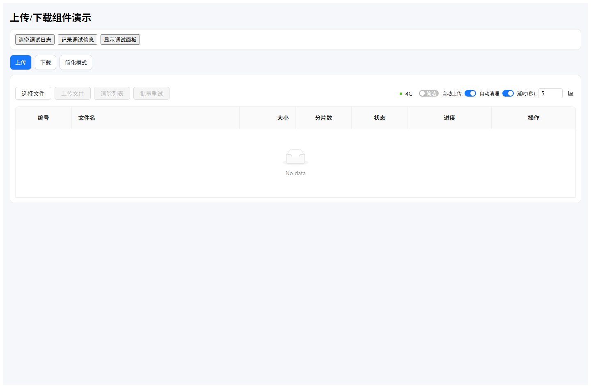
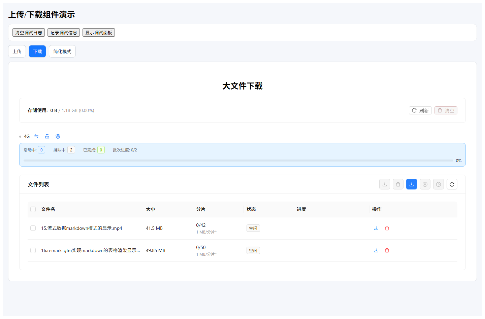
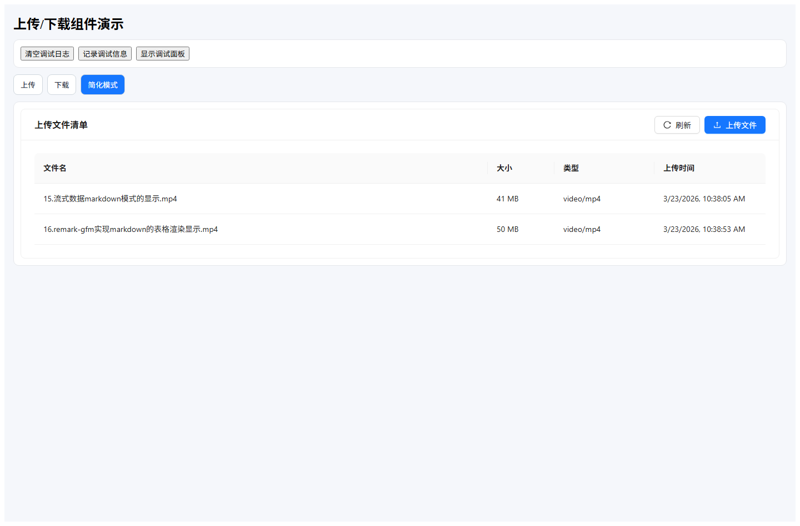
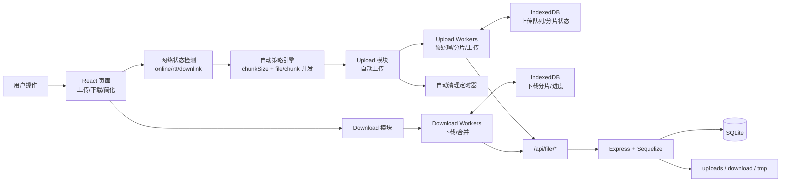
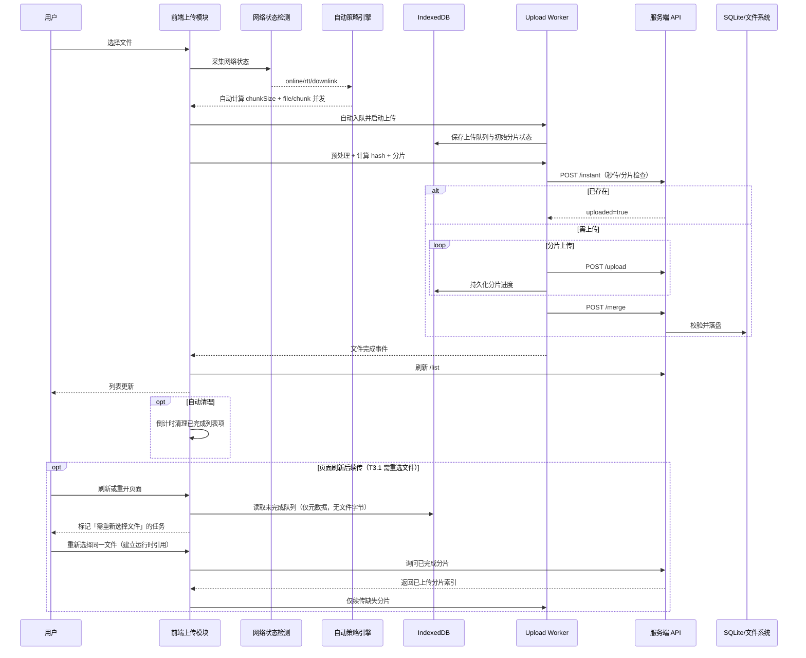
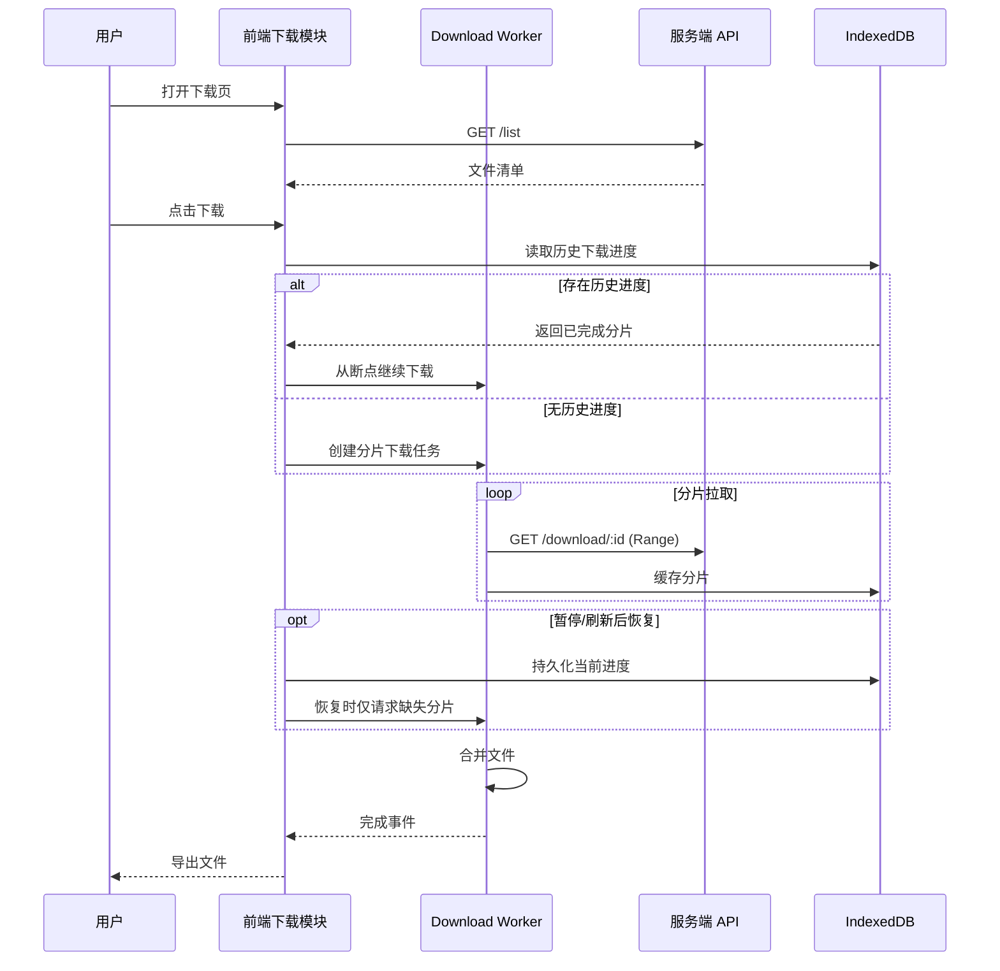

# react-upload-indexeddb

一个基于 `IndexedDB + 分片传输` 的大文件上传/下载演示项目，前后端统一使用 `/api/file/*` 协议，支持断点续传、秒传检查、分片下载、简化上传模式和调试日志面板。

## 项目目标

- 给新接手开发者提供可快速启动、可验证、可扩展的上传/下载演示基线
- 展示前端 IndexedDB 持久化 + Worker 分片处理 + 后端 SQLite 落盘的端到端链路
- 在“完整模式”之外提供“简化模式”，便于后续业务页面快速集成

## 核心能力

- 自动策略引擎：自动检测网络状态（online/offline/rtt/downlink），动态计算分片大小与并发度
- 完整上传模式：分片上传、秒传检查、失败重试、自动上传、批次进度
- 自动清理机制：上传完成后自动倒计时清理；简化模式批次结束时立即清理弹窗列表
- IndexedDB 持久化：上传队列、分片状态、下载分片与任务进度本地存储
- 流式分片上传（T3.1）：文件字节不再整文件驻留内存，上传时按分片 `File.slice()` 惰性读取，内存峰值与文件大小解耦
- 刷新续传（T3.1 语义变更）：页面刷新后**需重新选择同一文件**即可续传已上传分片——运行时文件引用不落盘，已完成分片由服务端分片检查自动跳过
- 下载模式：文件列表、分片下载、暂停/恢复、合并导出
- 简化模式：服务器文件清单 + 弹窗自动上传（上传后即时刷新清单）
- 统一文件名语义：列表和下载优先展示原始文件名（非物理存储名）
- 调试面板：前端日志记录、导出、问题排查辅助

## 界面示意

> 可通过 `npm run docs:screenshot` 重新生成以下截图（默认访问 `http://127.0.0.1:5173`）。

### 上传模式



完整上传链路与上传队列操作入口。

### 下载模式



服务器文件列表与分片下载控制入口。

### 简化模式



面向集成场景的最小操作界面：上传按钮 + 自动流程。

## 流程图（Mermaid 摘要）

### 架构总览



前端在“网络检测 + 自动策略 + IndexedDB 持久化”协同下执行上传/下载，后端负责分片状态、文件合并和文件列表聚合。

### 上传时序



上传链路中自动上传、自动清理、IndexedDB 持久化与刷新续传是同一条闭环能力。

### 下载时序



下载流程基于 IndexedDB 分片缓存实现暂停/恢复与刷新续传。

## 快速开始

## 环境要求

- Node.js 18+
- npm 9+

## 安装依赖

```bash
npm install
npm --prefix server install
```

## 启动服务

```bash
# 终端 1：后端
npm run server:dev

# 终端 2：前端
npm run dev
```

默认访问：

- 前端：`http://127.0.0.1:5173`
- 后端：`http://127.0.0.1:3000`

## 首次验证建议

1. 打开“上传”页上传一个文件，确认上传完成。
2. 切换“下载”页，确认新文件可见并可下载。
3. 切换“简化模式”，通过弹窗上传并观察清单即时刷新。

## 常用命令

| 命令                       | 说明                           |
| -------------------------- | ------------------------------ |
| `npm run dev`              | 启动前端开发服务               |
| `npm run server:dev`       | 启动后端服务                   |
| `npm run test:unit`        | 前端单元测试                   |
| `npm --prefix server test` | 后端集成测试                   |
| `npm run build`            | 前端构建（含 TypeScript 校验） |
| `npm run verify`           | 前后端联合验证                 |
| `npm run docs:screenshot`  | 生成 README 页面截图           |
| `npm run metrics:collect`  | 采集重构指标                   |

## 环境变量

参考根目录 `.env.example`：

- `VITE_API_BASE_URL`：前端 API 基础地址（生产/直连时使用）
- `VITE_DEV_API_PROXY_TARGET`：开发代理目标（默认 `http://localhost:3000`）

## SQLite UI 管理（可选）

如需可视化查看/排查服务端数据库，推荐使用 `DB Browser for SQLite`：

- 下载地址：https://sqlitebrowser.org/dl/
- 默认数据库文件：`server/data/indexeddb-upload.sqlite`
- 自定义数据库文件：可通过后端环境变量 `DB_STORAGE` 指定

建议操作：

1. 停止后端服务后再打开数据库，避免写锁冲突。
2. 在工具中打开 `server/data/indexeddb-upload.sqlite` 查看 `files` 与 `file_chunks` 表。
3. 若看到 `*.sqlite-wal` / `*.sqlite-shm` 文件，属于 SQLite WAL 正常产物。

## API 概览

统一前缀：`/api/file/*`

- 上传链路：`POST /instant`、`POST /upload`、`POST /merge`、`GET /status`
- 下载链路：`GET /list`、`GET /download/:file_id`

完整契约请查看：[docs/server-api-contract.md](./docs/server-api-contract.md)

## 目录导览

```text
src/                                  前端应用与上传/下载组件
server/                               后端服务（Express + SQLite + Sequelize）
docs/                                 交付文档、契约说明、架构说明
scripts/                              校验与辅助脚本（含 README 截图脚本）
```

## v2.0.0 重大变更（阶段三 · T3.1 起）

> 阶段三属 **major** 版本升级。以下变更与阶段四（去 antd / 去 ahooks）无关，自阶段三首版（T3.1）起生效。

### 1. `UploadFile.buffer` 字段移除（Breaking）

旧实现在 IndexedDB 中持久化整文件 `ArrayBuffer`（`file.buffer`），刷新恢复依赖它。T3.1 起：

- `UploadFile` 不再含 `buffer`；取而代之的是**运行时** `fileRef: File`，仅存在于当前会话内存，**不序列化进 IndexedDB**。
- 文件字节在上传时才由 Worker 通过 `fileRef.slice(start, end).arrayBuffer()` **逐分片惰性读取**，内存峰值 = `chunkSize × chunkConcurrency`，与文件大小无关（2GB 文件也不再峰值占满内存）。
- 页面刷新后 `fileRef` 丢失，记录标记为「需重新选择」（见下）。

### 2. 刷新续传语义变更（Breaking）

| 版本 | 刷新后行为 |
| --- | --- |
| ≤ v1.3.0 | 自动恢复未完成任务并续传（依赖落盘 buffer） |
| ≥ v2.0.0 | **重新选择同一文件**后，服务端分片检查自动跳过已传分片，仅补传缺失部分 |

原因：移除整文件驻留后，浏览器无法在刷新后凭空还原文件字节；重选是浏览器安全模型下的唯一可靠路径。秒传/已传分片跳过仍由服务端 `chunkCheckResult` 保障，不会重复上传。

### 3. 新增 `hashMode` prop（非 Breaking，可选）

```tsx
<ZustandFileUpload
  hashMode="full"   // 默认：全量流式哈希（内存与文件大小无关），服务端合并强校验
  // hashMode="sample" // 采样哈希：首 4MB+尾 4MB+中间 3 采样点+size，大文件可跳过绝大部分读取；
                       // 代价：极低概率采样碰撞（同大小且采样区一致的不同文件视为同一文件），
                       // 且服务端合并跳过全量 md5 强校验（分片级 md5 校验仍全覆盖）
/>
```

`hashMode` 贯穿 props → Context → 预处理 Worker（计算哈希）→ 上传 Worker（随请求下发 `hash_mode`）→ 服务端 `mergeChunks`（仅 `full` 模式校验全量 md5）。绝大多数场景保持默认 `"full"` 即可。

## 已知限制与边界

- 当前以演示与集成为主；客户端已支持鉴权注入（见下），服务端鉴权为可插拔参考实现
- 生产级场景仍需补充：高并发压测、审计日志、容灾和安全加固
- README 截图为一次性生成，UI 改动后需手动重拍

## 鉴权接入（auth）

组件本身不持有任何凭证，所有鉴权通过 **props 注入**，由消费方决定 Token 来源。

### credentials 默认语义（重要）

- 上传 Worker（`fetch`）与下载分片请求**默认 `same-origin`**：同域场景浏览器自动携带 Cookie；跨域 Bearer 头鉴权不会触发 CORS preflight 对 `Access-Control-Allow-Credentials:true` 的强校验。
- 仅当需要**跨域 Cookie** 鉴权时才显式设置 `withCredentials: true`（此时服务端必须返回 `Access-Control-Allow-Credentials:true`，且 `Access-Control-Allow-Origin` 不能为 `*`）。
- 下载侧列表请求走 axios，默认 `withCredentials: false`，语义同上。

### 三种接入组合

| 场景 | 上传侧 | 下载侧 | 服务端要求 |
| --- | --- | --- | --- |
| 跨域 Bearer（推荐） | `getAuthToken` / `authToken` / `getAuthHeaders`，`withCredentials` 保持默认 `false` | 同名 props（分片请求，v1.1.0 起） + `setDownloadAuth`（列表请求） | 校验 `Authorization` 头；CORS 暴露该头 |
| 同域 Cookie | 无需额外代码（默认 `same-origin` 自动携带） | 无需额外代码 | 校验 Cookie |
| 跨域 Cookie | `withCredentials: true` | `withCredentials: true` | `Access-Control-Allow-Credentials:true` + 具体 Origin |

```tsx
import { FileUpload } from "react-upload-indexeddb";

// 方式 A：每次上传前从存储取最新 token（推荐，支持刷新）
<FileUpload
  baseURL="https://upload.example.com"
  getAuthToken={async () => {
    const token = await readPortalToken(); // 你的登录态
    return token;
  }}
/>

// 方式 B：完全自定义头（最灵活，可同时塞多个业务头）
<FileUpload
  baseURL="https://upload.example.com"
  getAuthHeaders={async () => ({
    Authorization: `Bearer ${await readPortalToken()}`,
    "X-Tenant-Id": currentTenantId,
  })}
/>

// 方式 C：仅跨域 Cookie 鉴权时才需要显式开启
<FileUpload baseURL="https://upload.example.com" withCredentials={true} />
```

下载侧对应设置（与上传共享同一套鉴权头语义，v1.1.0 起分片请求同样生效）：

```tsx
import { FileDownload } from "react-upload-indexeddb";

<FileDownload
  baseURL="https://upload.example.com"
  getAuthToken={async () => await readPortalToken()}
/>
```

```ts
import { setDownloadAuth } from "react-upload-indexeddb";

// 下载列表请求（axios）的鉴权头注入；传 undefined 清除
setDownloadAuth({ Authorization: `Bearer ${token}` });
```

> 兼容说明：`setDownloadAuth` 写入 axios 实例，**v1.0.5 仅作用于文件列表请求**；分片 Range 请求的鉴权请使用 `FileDownload` 的 props 注入（v1.1.0）。

### 服务端对接（参考）

`server/src/middleware/auth.js` 提供可插拔鉴权工厂（支持 Bearer / Cookie）。默认关闭，设环境变量开启：

```bash
REQUIRE_FILE_AUTH=true
FILE_AUTH_TOKEN=dev-token-1,dev-token-2   # Bearer 白名单（演示）
FILE_AUTH_COOKIE=portal_token            # 同域 Cookie 名
```

> vane-crm 接入时，应把该中间件替换为自家鉴权（如 `portal_token` 校验 + RBAC），接口形态保持一致：校验失败返回 `401 { code:401, message, data:{} }`。

## 作为 npm 包使用（发布态）

本仓库同时是 demo 站点与可发布组件库：

- `npm run build` —— 产出库构建到 `dist/`（ESM `index.js` + CJS `index.cjs` + `index.d.ts` + `style.css`），`react` / `react-dom` / `zustand` 为 peerDependencies，由消费方提供。
- **UI 套件已自给自足（v1.3.0 起）**：内置极简 UI 套件 `rui-ui`（`src/ui/`，19 个组件 + 19 个内联 SVG 图标 + 15 kB CSS），**不再依赖 antd / @ant-design/icons**——未使用 antd 的消费方无需再安装 antd；已在用 antd 的消费方不受影响（两者样式互不干扰，`rui-` 前缀）。
- 样式引入（必须，否则组件无样式）：
  ```ts
  import "react-upload-indexeddb/dist/style.css";
  ```
- 运行时依赖（`dependencies`，安装本包时自动带入）：`axios`、`localforage`、`spark-md5`——仅此三个，无其他传递依赖（网络检测 hook 为自研实现，不依赖 ahooks）。
- `npm run build:demo` —— 产出演示站点（原有 `tsc -b && vite build`）。
- 消费方需自行安装 peer 依赖（`react` / `react-dom` / `zustand`）。
- `baseURL` 默认相对路径，建议始终通过 props 显式传入。

## 常见问题

### 1) 列表显示为物理存储名（hash）

后端已优先映射原始文件名；若仍异常，请确认后端已重启并刷新页面。

### 2) 本地看不到 Mermaid 图

请使用支持 Mermaid 的 Markdown 预览（如 GitHub 或 VS Code Mermaid 扩展）。

### 3) `docs:screenshot` 执行失败

- 确认前端页面可访问（默认 `http://127.0.0.1:5173`）
- 如端口不同，可设置 `README_SCREENSHOT_BASE_URL` 再执行脚本

## 文档索引

- 扩展文档索引（职责总览与阅读顺序）：[docs/README.md](./docs/README.md)
- 组件使用文档（Props / 回调 / 集成示例）：[docs/components.md](./docs/components.md)
- 架构详图与说明（流程图 / 时序图 / 自动策略）：[docs/architecture.md](./docs/architecture.md)
- API 契约（请求响应结构与错误语义）：[docs/server-api-contract.md](./docs/server-api-contract.md)
- 演示脚本（演示步骤 / 预期结果 / 验收模板）：[docs/demo-script.md](./docs/demo-script.md)
- 面试题库（项目亮点 / 常见追问 / 参考答案）：[docs/interview.md](./docs/interview.md)
