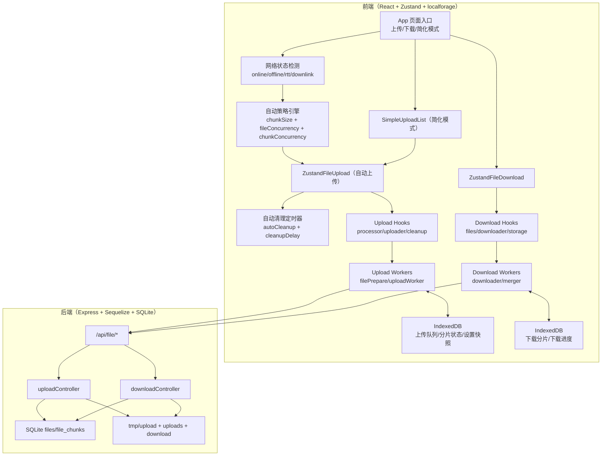
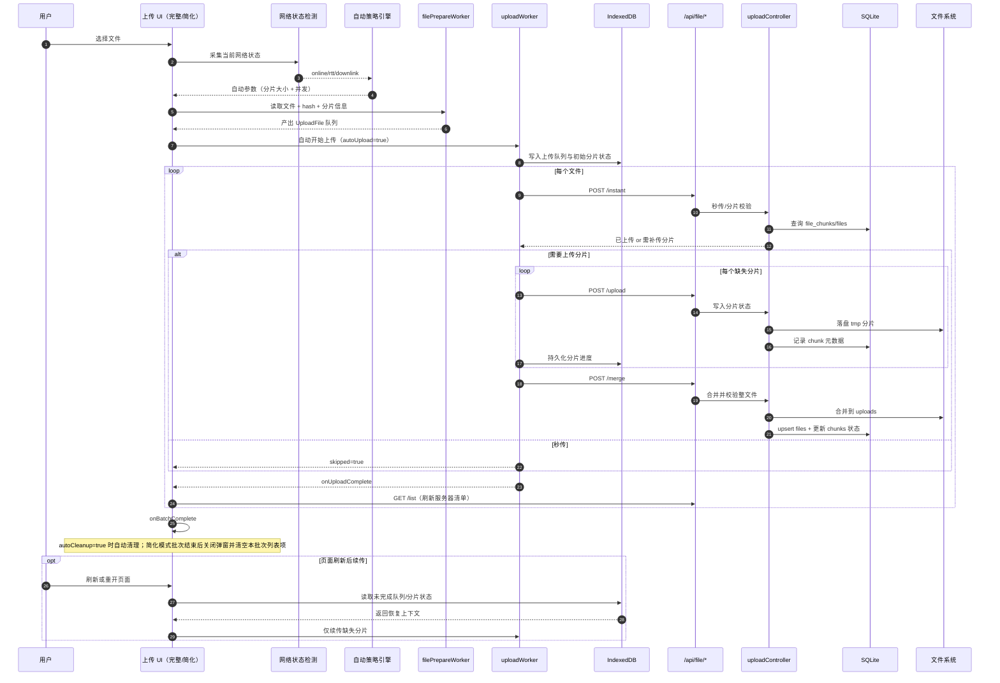
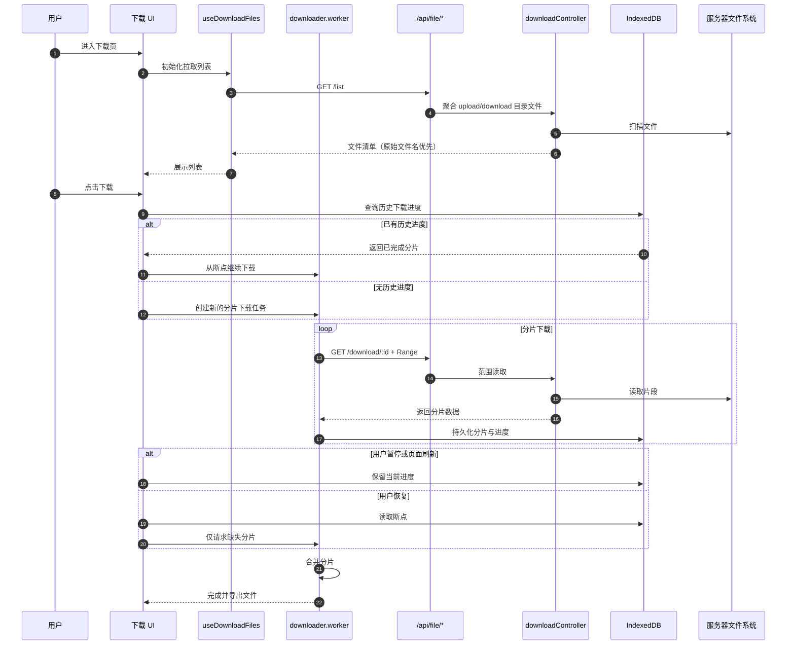
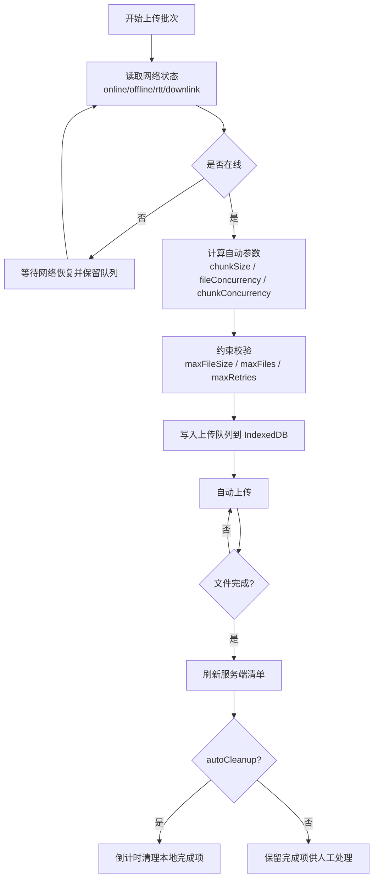
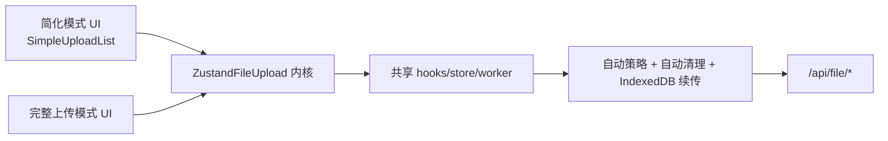
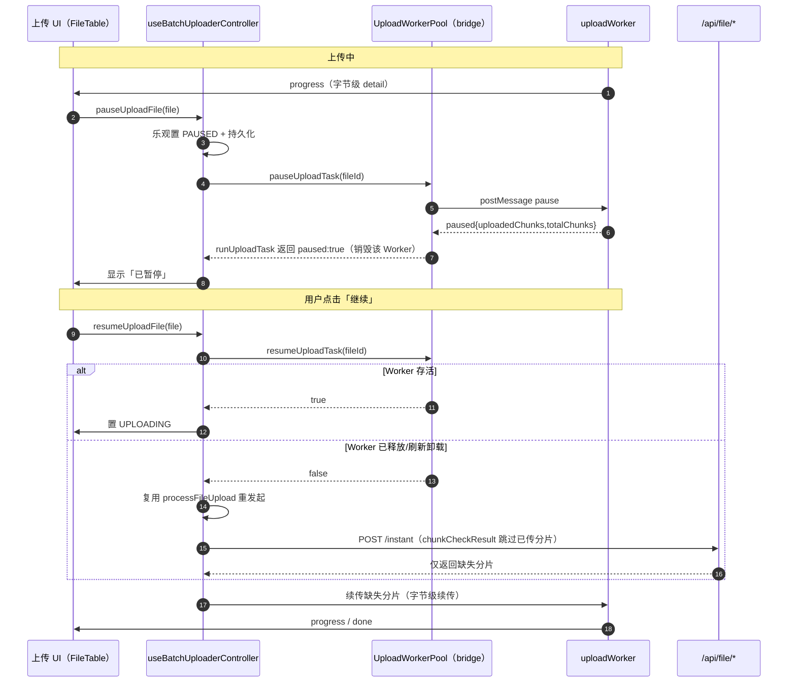

# 架构说明（含 Mermaid 详图）

本文是根 README 的架构补充，重点说明以下特色能力如何形成闭环：

## 文档职责

- 负责：系统模块关系、上传/下载链路、自动策略与续传机制的流程/时序说明。
- 不负责：组件逐项 Props 解释与 API 字段级契约字典。

- 自动检测网络状态
- 自动计算分片大小与并发
- 自动上传与自动清理
- IndexedDB 持久化存储
- 页面刷新后自动续传

## 1. 系统总览



## 2. 上传链路（完整/简化共享内核）



### 上传链路关键点

- 自动策略与上传逻辑解耦：网络采样变化只影响策略参数，不破坏上传协议。
- `instant + upload + merge` 维持一致事务语义：先校验、再补传、最后合并校验。
- 上传进度持续写入 IndexedDB，保证刷新后可恢复而不是重传整文件。
- 自动清理在 UI 层执行，避免影响服务端文件清单与后续集成。

## 3. 下载链路



### 下载链路关键点

- 下载使用 `Range` 请求，天然支持断点续传。
- 下载分片与进度写入 IndexedDB，暂停/刷新不会丢失上下文。
- 文件列表统一来自 `/api/file/list`，包含上传与下载目录聚合结果。

## 4. 自动策略决策流（上传）



## 5. 简化模式与完整模式关系



- 简化模式不维护第二套上传内核，只收敛 UI 操作复杂度。
- 完整模式保留参数调节和诊断能力；简化模式固定自动策略，适合集成页面。

## 6. 上传状态机（T3.3 收敛）

T3.3 收敛了共享上传状态机：删除从未被赋值的死状态 `CALCULATING` / `MERGE_ERROR`，
保留 `PAUSED`。关键约束：**`PAUSED` 不再是「可上传态」**——它由 `isUploadableStatus` 移除，
必须由用户显式点击「继续」触发 `resumeUploadFile`，避免与暂停中的 Worker 重复运行同一文件。

### 6.1 状态枚举（收敛后）

| 状态                | 含义                         | 是否可上传（`isUploadableStatus`） |
| ------------------- | ---------------------------- | --------------------------------- |
| `queued`            | 排队中                       | ✅                                |
| `queued-for-upload`  | 待上传（已入自动上传队列）     | ✅                                |
| `preparing-upload`  | 准备上传（预处理/秒传校验中）  | ✅                                |
| `uploading`         | 上传中                       | ✅                                |
| `paused`            | 已暂停（分片边界挂起）         | ❌（需显式「继续」）              |
| `error`             | 上传失败（可重试/续传）        | ✅                                |
| `done`              | 已完成                       | ❌                                |
| `instant`           | 秒传成功                     | ❌                                |

### 6.2 状态迁移图

```mermaid
stateDiagram-v2
  [*] --> queued: 选择文件
  queued --> queued-for-upload: 进入自动上传批次
  queued-for-upload --> preparing-upload: 预处理/秒传校验
  preparing-upload --> uploading: 开始分片上传
  preparing-upload --> error: 校验失败/无文件引用
  uploading --> paused: 用户点「暂停」（Worker 分片边界挂起）
  uploading --> done: 全部分片上传+合并成功
  uploading --> instant: 服务端命中秒传
  uploading --> error: 分片上传失败（超限重试）
  paused --> uploading: 用户点「继续」→ resumeUploadFile（Worker 已释放则重跑 processFileUpload，服务端分片校验续传）
  error --> queued: 重试前复位
  error --> preparing-upload: 用户点「重试」
  done --> [*]
  instant --> [*]
  error --> [*]: 用户删除
  paused --> [*]: 用户删除（复位为 queued）
```

### 6.3 暂停 / 恢复 时序（T3.3）



要点：
- `pause` 是**分片边界安全暂停**——已发出的在途分片请求会继续完成，下一分片起始前挂起；
- 暂停态下 Bridge 直接销毁对应 Worker（不回空闲池），彻底消除挂起闭包与 Map 残留；
- 继续时若 Worker 已不在（`resumeUploadTask` 返回 `false`），回落到重跑 `processFileUpload`，
  由服务端分片校验保证字节级续传，无需用户重新选择（除非 `fileRef` 已随刷新失效）。

