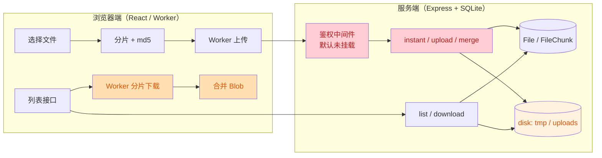

# 项目审查报告（React 性能 / 安全 / 通用代码审查）

- 审查日期：2026-10-24
- 审查范围：`src/`（React + Vite 前端组件库与 demo）、`server/`（Express + Sequelize/SQLite 服务端）、`index.html`、`vite.config.ts`、依赖清单
- 使用规范：
  - Vercel React Best Practices（65 条规则，8 个类别）
  - `security-best-practices`：`javascript-typescript-react-web-frontend-security.md`、`javascript-express-web-server-security.md`
  - TRAE-code-review 通用审查流程（含两轮独立复核）
- 说明：本次是**全量代码审查**，不是 MR diff 审查；所有结论均给出文件与行号证据。CDN/反向代理层面的配置不在仓库内，相关项标注为“需在部署侧核实”。

---

## 一、执行摘要

项目整体工程质量高于平均水平：前端没有 `dangerouslySetInnerHTML` / `innerHTML` / `eval` 等 XSS 逃生口，`lazy + Suspense` 已按路由/页签拆包，`manualChunks` 做了 vendor 拆分，Zustand 已按实例隔离并用 `useShallow` 收敛重渲染，Worker 内鉴权头按文件生命周期清理；服务端已有参数化查询、分片 md5 比对、Range 下载、限流、合并锁、孤儿分片清理等设计。

主要风险集中在**服务端默认安全基线**与**端到端完整性校验**两处：

1. **文件接口默认无鉴权**（默认配置即为公开上传/列表/下载），且 CORS 默认反射任意来源。
2. **完整性校验可被客户端绕过**（`hash_mode=sample` 跳过整文件 md5，且未校验合并后真实大小），秒传结果可被污染。
3. **上传侧没有容量/分片数上限**，可被用于磁盘耗尽型 DoS。
4. **下载侧不校验 206/Content-Range，也没有最终 md5 校验**，服务端或代理忽略 Range 时会静默产出损坏文件。
5. **生产依赖存在已知漏洞**（服务端 1 critical / 3 high，前端 1 critical / 1 high）。

| 级别   | 数量 | 编号                               |
| ------ | ---- | ---------------------------------- |
| High   | 6    | S1、S2、S3、F4、D1、F5             |
| Medium | 9    | S4、S5、S6、S7、S9、F1、F2、F3、F6 |
| Low    | 7    | S8、S10、S11、F7、F8、F9、P1       |

> 置信度说明：S1–S8 经两名独立复核者分别确认（2/2）；其余条目由主审读取源码逐条确认（1/1，证据充分）。

---

## 二、问题总览

红色为“默认开启且缺少防护”的入口，橙色为“缺少完整性/边界校验”的环节。

---

## 三、High

### S1 文件接口默认无鉴权（默认配置即公开）

- 规则：EXPRESS-AUTH-001 / REACT-AUTHZ-001；“前端鉴权只是 UX，服务端必须强制”
- 位置：[app.js](file:///e:/react-upload-indexeddb/server/src/app.js#L62-L82)、[fileRoutes.js](file:///e:/react-upload-indexeddb/server/src/routes/fileRoutes.js#L8-L15)
- 证据：只有 `process.env.REQUIRE_FILE_AUTH === "true"` 时才挂载 `createAuthMiddleware`；未设置该变量时，`/api/file/instant`、`/upload`、`/merge`、`/list`、`/download/:id` 全部匿名可访问。
- 影响：任意网络可达者可以上传任意文件、枚举全部文件元数据、下载全部文件；`uploads/` 与 `tmp/` 磁盘由攻击者驱动增长。中间件本身是 fail-closed 的，问题在于**默认没挂载**。
- 建议：把“是否启用鉴权”改为显式白名单（如 `AUTH_MODE=demo` 才关闭，生产默认开启 fail-closed）；README/`.env.example` 中把 `REQUIRE_FILE_AUTH=true` 写成生产必需项。
- 置信度：高（2/2）

### S2 完整性校验可被客户端绕过（秒传污染）

- 规则：EXPRESS-INPUT-001 / EXPRESS-UPLOAD-001
- 位置：[uploadController.js](file:///e:/react-upload-indexeddb/server/src/controllers/uploadController.js#L404-L415)、[uploadController.js](file:///e:/react-upload-indexeddb/server/src/controllers/uploadController.js#L324-L376)
- 证据：
  - `if (hash_mode !== "sample") { ... md5File(targetPath) ... }`，即客户端传 `hash_mode=sample` 即可跳过整文件 md5 校验；
  - `size` 只作为入参写入 `File.upsert`，合并后没有 `stat(targetPath).size === Number(size)` 的校验；
  - 秒传判定只看 `md5 + size`（[L201-L207](file:///e:/react-upload-indexeddb/server/src/controllers/uploadController.js#L201-L207)），而 `md5` 由客户端上报。
- 影响：攻击者可声明“某 md5/size 的文件”，用 `sample` 模式跳过终检并写入内容不同的文件；后续所有用户对该 md5 的“秒传”都会命中这条被污染记录，且下载得到的文件与 md5 不符。属于存储型完整性/供应链风险。
- 建议：`hash_mode` 改为服务端配置项或强制 `full`；无论何种模式，落库前都要校验 `stat.size === Number(size)`；秒传命中后仍需可选的抽样/全量复核。
- 置信度：高（2/2）

### S3 上传缺少容量与分片数上限（磁盘耗尽 DoS）

- 规则：EXPRESS-DOS-001 / EXPRESS-BODY-001
- 位置：[uploadController.js](file:///e:/react-upload-indexeddb/server/src/controllers/uploadController.js#L379-L402)、[uploadChunk.js](file:///e:/react-upload-indexeddb/server/src/middleware/uploadChunk.js#L13-L18)、[app.js](file:///e:/react-upload-indexeddb/server/src/app.js#L25-L26)
- 证据：单分片限制 20MB，但 `index` 无上界、`total` 只校验“正整数”、`size` 无上界；每个分片独立 `writeFile` 到 `tmp/upload`，只有 6 小时一次的 janitor 清理 24h 前的孤儿分片。
- 影响：攻击者可用极低带宽写入海量分片文件，占满磁盘；限流为全局 300 次/分钟/IP，且分布式来源下不构成有效约束。
- 建议：为 `size` 设服务端上限（如 `MAX_UPLOAD_SIZE_MB`）、`total` 与 `index` 设上界（`index < total`）、单 `file_id` 的累计分片数与累计字节数配额；结合 `Content-Length` 或速率限制做前置拦截。
- 置信度：高（2/2）

### F4 下载分片不校验 206 / Content-Range，可能静默产出损坏文件

- 规则：客户端数据完整性 / 前端网络层
- 位置：[downloader.worker.ts](file:///e:/react-upload-indexeddb/src/components/ZustandFileDownload/worker/downloader.worker.ts#L296-L330)
- 证据：`fetch(url, { headers: { Range }, ... })` 之后只检查 `response.ok` 与 `blob.size === 0`，没有校验 `status === 206`、`Content-Range` 起始位置，也没有校验 `blob.size === expectedChunkSize`。
- 影响：若服务端/代理/网关忽略 Range 返回 `200` 全量文件，Worker 会把整文件当作某个分片写入，合并结果损坏且进度显示正常；这是“看起来成功”的数据损坏。
- 建议：要求 `206`，解析并校验 `Content-Range` 与期望 `start/end` 一致，校验 `blob.size === end-start+1`；不满足则按失败重试，而不是继续。
- 置信度：高（主审已读源码确认）

### F5 合并与完成阶段无最终完整性校验

- 规则：客户端数据完整性
- 位置：[merger.worker.ts](file:///e:/react-upload-indexeddb/src/components/ZustandFileDownload/worker/merger.worker.ts#L20-L44)、[mergeService.ts](file:///e:/react-upload-indexeddb/src/components/ZustandFileDownload/services/mergeService.ts#L57-L61)
- 证据：合并仅校验 `chunks.length === totalChunks`，随后 `new Blob(chunks)` 直接标记 `COMPLETED`；列表接口返回的 `metadata.md5` 从未参与校验。
- 影响：分片被截断、被缓存替换或服务端内容变更时，用户会拿到损坏文件且无任何提示。
- 建议：对合并后 Blob 计算 md5（或抽样哈希）并与列表返回的 `md5` 比对；不一致时标记失败并保留分片供重试。注意 `spark-md5` 已在依赖中，可增量计算避免内存翻倍。
- 置信度：高

### D1 生产依赖存在已知漏洞

- 规则：REACT-SUPPLY-001 / EXPRESS-DEPS-001
- 证据（`npm audit --omit=dev` 实测）：
  - 服务端：10 个漏洞（1 critical / 3 high / 6 moderate）。critical：`proxy-addr`（Express 传递依赖）；high：`body-parser`、`path-to-regexp`（Express 传递依赖）、`lodash`（Sequelize 传递依赖）；moderate：`sequelize`（经 `uuid`）、`file-type`、`morgan`、`qs`、`moment`、`uuid`。
  - 前端：`form-data` critical（axios 传递依赖）、`axios` high、`follow-redirects` moderate。
- 影响：HTTP 解析/代理信任相关漏洞与请求走私、拒绝服务相关；axios 相关漏洞影响所有上传下载请求。
- 建议：升级 `express` 到当前维护版本、`axios` 到最新 1.x；`sequelize` 升级需单独评估（`npm audit fix --force` 会建议降到 `sequelize@3.30.0`，属破坏性降级，**不要照做**）；CI 增加 `npm audit --omit=dev` 门禁。
- 置信度：高（命令实测输出）

---

## 四、Medium

| 编号 | 问题                                         | 位置                                                                                                                                                                                                                                             | 影响与建议                                                                                                                                                                                                                                                |
| ---- | -------------------------------------------- | ------------------------------------------------------------------------------------------------------------------------------------------------------------------------------------------------------------------------------------------------ | --------------------------------------------------------------------------------------------------------------------------------------------------------------------------------------------------------------------------------------------------------- |
| S4   | CORS 默认反射任意 Origin                     | [app.js#L12-L23](file:///e:/react-upload-indexeddb/server/src/app.js#L12-L23)                                                                                                                                                                    | `CORS_ORIGIN` 未配置时 `origin: true`。叠加 S1 后，任意站点可跨域读取文件列表/触发上传。建议默认不开启 CORS，或在生产强制显式 origin 白名单并做启动校验。                                                                                                 |
| S5   | 缺少安全响应头与指纹收敛                     | [app.js#L8-L83](file:///e:/react-upload-indexeddb/server/src/app.js#L8-L83)                                                                                                                                                                      | 无 `helmet`、无 `X-Content-Type-Options`、无 `frame-ancestors`、未 `app.disable('x-powered-by')`、无自定义 404。建议引入 `helmet()` 并补 404 处理。                                                                                                       |
| S6   | 错误响应泄漏内部信息                         | [app.js#L84-L90](file:///e:/react-upload-indexeddb/server/src/app.js#L84-L90)、各 controller 的 `jsonError(500, error.message)`                                                                                                                  | 数据库/文件系统错误原文（路径、SQL 片段）会返回客户端。建议生产只返回通用文案，细节落服务端日志。                                                                                                                                                         |
| S7   | Cookie 解析可抛异常 + Token 明文比较         | [auth.js#L21-L31](file:///e:/react-upload-indexeddb/server/src/middleware/auth.js#L21-L31)、[auth.js#L45-L59](file:///e:/react-upload-indexeddb/server/src/middleware/auth.js#L45-L59)                                                           | `decodeURIComponent` 遇到畸形 `%` 会抛 `URIError`，在中间件中变成 500；`bearerTokens.includes(token)` 为逐字符短路比较。建议 try/catch 包住解码（失败视为无 cookie），并用 `crypto.timingSafeEqual` + 固定长度比较。                                      |
| S9   | `user_id` / `category_id` 由客户端决定       | [uploadController.js#L267-L304](file:///e:/react-upload-indexeddb/server/src/controllers/uploadController.js#L267-L304)、[uploadController.js#L437-L457](file:///e:/react-upload-indexeddb/server/src/controllers/uploadController.js#L437-L457) | 请求体中的归属字段未校验，任何人可伪造文件归属（一旦开启鉴权则升级为越权风险）。建议启用鉴权后从会话/令牌推导 `user_id`，并对 `category_id` 做存在性校验。                                                                                                |
| F1   | localStorage 读取无异常保护、key 无命名空间  | [upload.ts#L190-L253](file:///e:/react-upload-indexeddb/src/components/ZustandFileUpload/store/upload.ts#L190-L253)                                                                                                                              | `JSON.parse(localStorage.getItem(...))` 未 try/catch，被污染/半写入的数据会让 store 初始化直接抛错；`autoUpload`、`cleanupDelay` 等是全局 key，同域多实例/多应用会互相覆盖。建议集中封装 `safeStorage`（try/catch + 校验 + 版本号），key 加 `rui:` 前缀。 |
| F2   | Zustand persist 无版本迁移，持久化了派生字段 | [store/index.ts#L251-L271](file:///e:/react-upload-indexeddb/src/components/ZustandFileDownload/store/index.ts#L251-L271)                                                                                                                        | `networkType`、`chunkSize`、`fileConcurrency` 会随网络自适应变化，却被持久化；升级后旧结构无 `version/migrate`，残留字段会覆盖新的自适应结果。建议加 `version` + `migrate`，并只持久化真正的用户偏好（`displayMode`、`show*`、`maxRetries` 等）。         |
| F3   | Worker 对任意 URL 携带鉴权头请求             | [downloader.worker.ts#L289-L304](file:///e:/react-upload-indexeddb/src/components/ZustandFileDownload/worker/downloader.worker.ts#L289-L304)                                                                                                     | `url` 来自列表接口（或调用方 props），却直接附带 `Authorization`/自定义头。后端被篡改或配置错误时，token 会被发往任意域名。建议对下载 URL 做同源/白名单校验，非白名单目标剥离鉴权头（REACT-NET-001）。                                                    |
| F6   | 无 ErrorBoundary，懒加载失败整页白屏         | [App.tsx#L19-L27](file:///e:/react-upload-indexeddb/src/App.tsx#L19-L27)、[App.tsx#L374-L505](file:///e:/react-upload-indexeddb/src/App.tsx#L374-L505)                                                                                           | 发布后旧 chunk 404 或网络抖动会让 `lazy` 抛错，Suspense 不能捕获错误，页面整体白屏。建议在外层加 ErrorBoundary，并提供“刷新/重载资源”兜底。                                                                                                               |

---

## 五、Low

| 编号 | 问题                                    | 位置                                                                                                                                                                                                                                                                                       | 建议                                                                                                                                                                     |
| ---- | --------------------------------------- | ------------------------------------------------------------------------------------------------------------------------------------------------------------------------------------------------------------------------------------------------------------------------------------------ | ------------------------------------------------------------------------------------------------------------------------------------------------------------------------ |
| S8   | 限流按 `req.ip`，但未配置 `trust proxy` | [app.js#L29-L43](file:///e:/react-upload-indexeddb/server/src/app.js#L29-L43)                                                                                                                                                                                                              | 部署在反向代理后时所有请求共享代理 IP：限流要么误伤全员，要么被绕过。建议按实际拓扑设置 `app.set('trust proxy', <跳数/网段>)`。                                          |
| S10  | 缩略图 URL 无对应静态路由               | [downloadController.js#L54-L57](file:///e:/react-upload-indexeddb/server/src/controllers/downloadController.js#L54-L57)、[downloadController.js#L149-L166](file:///e:/react-upload-indexeddb/server/src/controllers/downloadController.js#L149-L166)                                       | 返回 `/uploads/xxx_thumb.ext`，但 `app.js` 未挂 `express.static`，缩略图必然 404（功能缺陷）。建议新增受控缩略图路由（带鉴权、`Content-Disposition: inline` 仅限图片）。 |
| S11  | Range 解析不完整                        | [downloadController.js#L323-L352](file:///e:/react-upload-indexeddb/server/src/controllers/downloadController.js#L323-L352)                                                                                                                                                                | 多段 Range（`bytes=0-1,5-6`）会被错误解析为单段，非法格式返回 416 但缺少 `Content-Range: bytes */size`。建议只支持单段并显式拒绝多段，补标准响应头。                     |
| F7   | 调试日志无上限，生产仍 `console.log`    | [useDebugLogger.ts#L27-L53](file:///e:/react-upload-indexeddb/src/hooks/useDebugLogger.ts#L27-L53)                                                                                                                                                                                         | `logs` 数组无界增长且长期持有 `data` 对象，长会话内存持续上涨。建议限长（如 500 条环形）、生产环境关闭 `console.log`。                                                   |
| F8   | 分片重试 off-by-one，文件级重试不重置   | [downloader.worker.ts#L147-L157](file:///e:/react-upload-indexeddb/src/components/ZustandFileDownload/worker/downloader.worker.ts#L147-L157)、[downloader.worker.ts#L271-L282](file:///e:/react-upload-indexeddb/src/components/ZustandFileDownload/worker/downloader.worker.ts#L271-L282) | `> MAX_RETRY_ATTEMPTS` 实际允许 4 次；文件级 `retryAttempts` 成功后不归零，长下载中 3 次偶发失败就会整文件中止。建议改为 `>=` 并在批次全部成功后重置。                   |
| F9   | 入口 HTML 无 CSP 等安全头               | [index.html](file:///e:/react-upload-indexeddb/index.html#L1-L12)                                                                                                                                                                                                                          | demo 影响有限，但作为可分发组件库，README 应提示宿主设置 CSP/`nosniff`/`frame-ancestors`，并给出与 Worker(`worker-src blob:`)、内联样式兼容的策略示例。                  |
| P1   | 分片批次间固定等待                      | [downloader.worker.ts#L215-L217](file:///e:/react-upload-indexeddb/src/components/ZustandFileDownload/worker/downloader.worker.ts#L215-L217)                                                                                                                                               | 每批固定 `setTimeout(10)`（首片 100ms），大文件多批次时累积拖慢吞吐；建议改为仅在有失败/限速信号时退避。                                                                 |

---

## 六、React 性能专项结论

按 Vercel 规则逐类核对，本项目**没有明显性能债务**，以下为核对结果：

| 类别                   | 结论                                                                                                                                                                                                                                                                                                             |
| ---------------------- | ---------------------------------------------------------------------------------------------------------------------------------------------------------------------------------------------------------------------------------------------------------------------------------------------------------------- |
| 消除瀑布（async-）     | 列表请求有在途去重（[api.client.ts#L150-L180](file:///e:/react-upload-indexeddb/src/components/ZustandFileDownload/api.client.ts#L150-L180)），下载分片用 `Promise.all` 按批并发。无连续 await 串行问题。                                                                                                        |
| 包体积（bundle-）      | 已用 `lazy` 拆分四个页签；`manualChunks` 拆 vendor/feature（[vite.config.ts#L75-L115](file:///e:/react-upload-indexeddb/vite.config.ts#L75-L115)）。仅 [`index.tsx`](file:///e:/react-upload-indexeddb/src/components/ZustandFileDownload/index.tsx#L6) 走 `./components` barrel，影响很小，可按需改为直接导入。 |
| 重渲染（rerender-）    | Zustand 选择器 + `useShallow`、`React.memo`、`useMemo`/`useCallback` 使用到位（`FileList.tsx`、`FileTable.tsx` 的列定义、行索引 Map 均已 memo）。                                                                                                                                                                |
| 渲染性能（rendering-） | 文件表未做虚拟滚动；10 万级文件列表会卡顿，但受 `maxFiles`/分页约束，当前规模可接受。                                                                                                                                                                                                                            |
| JS 性能（js-）         | 行索引用 `Map`、状态集合用 `Set`（[FileTable.tsx#L52-L56](file:///e:/react-upload-indexeddb/src/components/ZustandFileUpload/components/FileTable.tsx#L52-L56)、[FileList.tsx#L58-L63](file:///e:/react-upload-indexeddb/src/components/ZustandFileDownload/components/FileList.tsx#L58-L63)）。                 |
| 客户端数据（client-）  | 列表有 5s 节流 + 在途去重；localStorage 问题见 F1/F2。                                                                                                                                                                                                                                                           |

服务端性能备注（非安全问题）：[downloadController.js#L79-L123](file:///e:/react-upload-indexeddb/server/src/controllers/downloadController.js#L79-L123) 在列表扫描循环中使用同步 `fs.existsSync`/`fs.stat`；[uploadController.js#L79-L109](file:///e:/react-upload-indexeddb/server/src/controllers/uploadController.js#L79-L109) 的分片核对同为同步 IO。已有 5s 列表缓存缓解，文件量很大时建议改为 `fs.promises` 并发批处理。

---

## 七、已验证的安全优点（无需修改）

- 前端无 `dangerouslySetInnerHTML`、`innerHTML`、`insertAdjacentHTML`、`document.write`、`eval`/`new Function`。
- 所有用户数据经 JSX 转义渲染，未构造 HTML 字符串。
- 鉴权头注入统一收敛在 [authHeaders.ts](file:///e:/react-upload-indexeddb/src/shared/authHeaders.ts#L29-L58)，默认 `same-origin`，不隐式携带 Cookie。
- Worker 内的鉴权配置按文件清理，取消/完成即删除（[downloader.worker.ts#L195-L204](file:///e:/react-upload-indexeddb/src/components/ZustandFileDownload/worker/downloader.worker.ts#L195-L204)、[L392-L402](file:///e:/react-upload-indexeddb/src/components/ZustandFileDownload/worker/downloader.worker.ts#L392-L402)）。
- 服务端无字符串拼接 SQL（Sequelize 参数化），无 `child_process`，无出站 SSRF。
- 文件名/分片键均做白名单化清洗（[fileSecurity.js](file:///e:/react-upload-indexeddb/server/src/utils/fileSecurity.js#L4-L31)），下载按 sha256 文件 ID 映射，无路径遍历入口。
- 上传分片有 md5 比对、合并有并发锁与短事务拆分，Range 下载对越界返回 416 并正确销毁流。

---

## 八、建议修复顺序

1. **P0（当天）**：S1 默认鉴权、S4 CORS 收紧、S6 错误信息脱敏 —— 决定“能否安全暴露到公网”。
2. **P0（本周）**：S2 强制完整性校验、S3 容量上限、D1 依赖升级（先 Express/axios）。
3. **P1**：F4/F5 下载端 206/Content-Range 与 md5 终检、S7 鉴权解析加固。
4. **P2**：F1/F2 本地存储治理、F3 下载 URL 白名单、F6 ErrorBoundary、S5/S10/S11/F7/F8/P1 收尾。

## 九、复核说明

- 两名独立复核者对 S1–S8 逐条核对源码，结论一致（2/2 确认存在），未发现误报。
- 主审对 S9–S11、F1–F9、P1 逐条读取上下文确认；F6、F9、P1 属健壮性/体验类改进，不是当前的安全缺陷。
- 依赖结论来自本机 `npm audit --omit=dev` 实际输出，未做任何升级尝试，避免破坏现有测试。
